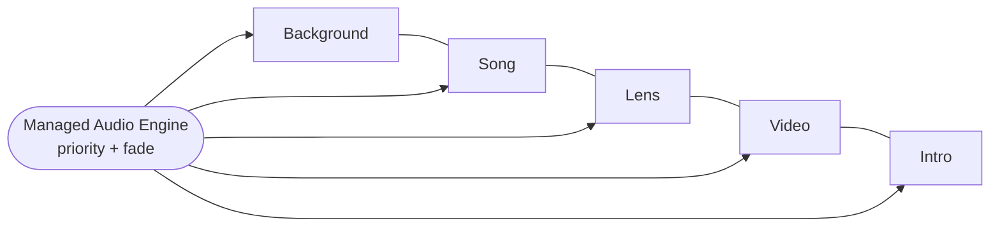
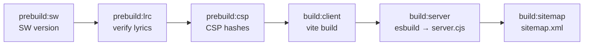

<div align="center">

<a id="top"></a>

# NL — Noureddin El Mobaraki

**Official Web Platform of the Moroccan rap artist and independent producer**
<br>
<sub>also known as <b>Nordine GB</b></sub>

<br>

<p>
  <a href="https://noureddinelmobaraki-web.github.io/NL/"></a>
  <a href="https://github.com/noureddinelmobaraki-web/NL"></a>
  
  
</p>

<p>
  
  
  
  
</p>

<p>
  
  
  
  
  
</p>

<p>
  
  
  
  
</p>

<br>

<table>
  <tr>
    <td align="center" width="33%">
      <b>Immersive Player</b><br>
      <sub>Adaptive HLS audio &amp; video streaming</sub>
    </td>
    <td align="center" width="33%">
      <b>Retro World</b><br>
      <sub>Interactive cassette / radio simulator</sub>
    </td>
    <td align="center" width="33%">
      <b>SEO-First Static</b><br>
      <sub>JSON-LD · Sitemap · Share cards</sub>
    </td>
  </tr>
</table>

<br>

<a href="https://noureddinelmobaraki-web.github.io/NL/"><b>Visit the Live Platform</b></a>
&nbsp;&nbsp;|&nbsp;&nbsp;
<a href="https://github.com/noureddinelmobaraki-web/NL"><b>View the Source Repository</b></a>

</div>

<br>

---

<br>

## Overview

The official single-page web platform of Moroccan rap artist and independent producer **Noureddin El Mobaraki**, known as **NL** / **Nordine GB**.

The platform combines four core pillars into one cohesive experience:

| Pillar | Summary |
| :--- | :--- |
| **Immersive Media Player** | Adaptive HLS audio and video playback with a managed, priority-based audio engine. |
| **Retro Cassette-Radio World** | An interactive, nostalgic simulator with its own dedicated ambience track. |
| **Automated Social Share Pages** | Pre-rendered static pages with rich preview cards for social platforms. |
| **Strict, SEO-First Static Deployment** | Canonical URLs, structured data, image sitemap, and a hardened Content Security Policy. |

<br>

> <div dir="rtl"><b>بالعربية:</b> هذا الموقع هو المنصة الرسمية للفنان المغربي <b>نور الدين المباركي (NL / Nordine GB)</b> — مشغّل موسيقى تفاعلي، أرشيف إصدارات، وعالم ريترو، مع دعم كامل للفهرسة (SEO) والعربية/الإنجليزية.</div>

<br>

<table align="center">
  <tr>
    <th align="left">Resource</th>
    <th align="left">Link</th>
  </tr>
  <tr>
    <td>Live Site</td>
    <td><a href="https://noureddinelmobaraki-web.github.io/NL/">noureddinelmobaraki-web.github.io/NL/</a></td>
  </tr>
  <tr>
    <td>Source Repository</td>
    <td><a href="https://github.com/noureddinelmobaraki-web/NL">github.com/noureddinelmobaraki-web/NL</a></td>
  </tr>
  <tr>
    <td>Media CDN</td>
    <td><a href="https://noureddinelmobaraki-web.github.io/nl-audio-cdn">noureddinelmobaraki-web.github.io/nl-audio-cdn</a></td>
  </tr>
</table>

<br>

---

## Table of Contents

<table>
  <tr>
    <td valign="top" width="33%">

**Introduction**

- [Overview](#overview)
- [Features](#features)
- [Tech Stack](#tech-stack)
- [Architecture](#architecture)
- [Project Structure](#project-structure)

</td>
    <td valign="top" width="33%">

**Development**

- [Getting Started](#getting-started)
- [Scripts](#scripts)
- [Build Pipeline](#build-pipeline)
- [Testing &amp; QA](#testing--qa)

</td>
    <td valign="top" width="33%">

**Operations**

- [Security &amp; CSP](#security--csp)
- [SEO Architecture](#seo-architecture)
- [Deployment](#deployment)
- [Distribution Channels](#distribution-channels)
- [Contributing](#contributing)
- [License](#license)

</td>
  </tr>
</table>

---

## Features

| Feature | Description |
| :--- | :--- |
| **Immersive media player** | Adaptive HLS (`.m3u8`) streaming via `hls.js`, with a managed audio engine that prioritizes sources (background, song, lens, video, intro) so they never overlap. |
| **Retro world** | An interactive cassette/radio simulator with its own ambience track. |
| **Automated share pages** | Pre-rendered static wrappers under `public/share/` with rich Open Graph / Twitter cards for WhatsApp, Facebook and X previews. |
| **SEO-first** | Canonical URL, `Person` JSON-LD, image sitemap, and an absolute `robots.txt` sitemap reference. |
| **Strict CSP** | Inline-script hashes generated at build time; no `unsafe-inline` for scripts. |
| **Service worker** | Versioned at build time for safe cache invalidation. |
| **RTL-first** | `index.html` ships `lang="ar" dir="rtl"` with bilingual metadata. |
| **Mobile QA overlay** | A `?qa=1` developer HUD for live viewport / breakpoint / context inspection. |

### Audio Engine Priority Model

The managed audio engine guarantees that only one source is audible at a time. Each source category is handled with priority and fade logic so transitions stay smooth:



<p align="right"><a href="#top">Back to top</a></p>

---

## Tech Stack

| Layer | Technology | Notes |
| :--- | :--- | :--- |
| UI runtime | **React 19** | Hooks-based; React Compiler enabled (`babel-plugin-react-compiler`). |
| Bundler | **Vite 6** | esbuild + Rollup pipeline; visualizer for `analyze`. |
| Language | **TypeScript ~5.9** | `tsc --noEmit` enforced in CI lint. |
| Styling | **Tailwind CSS v4** | Native Vite plugin (`@tailwindcss/vite`). |
| Animation | **Framer Motion v12** | Physics-based transitions. |
| Streaming | **hls.js 1.6** | Adaptive bitrate audio/video. |
| Dev/SSR server | **Express 5 (tsx)** | `server.ts`, bundled with esbuild for production. |
| Tests | **Vitest 4** | jsdom + Testing Library. |
| Icons | **lucide-react** | Consistent, tree-shakeable SVG icon set. |
| Images | **sharp** | WebP optimization pipeline. |

> [!NOTE]
> Always treat `package.json` as the source of truth for exact versions.

<p align="right"><a href="#top">Back to top</a></p>

---

## Architecture

```
+-------------------------------------------------------------+
|                 CLIENT APPLICATION (SPA)                    |
|       React 19 · Vite 6 · Tailwind v4 · Framer Motion       |
+-------------------------------------------------------------+
|  - Managed audio engine (priority + fade)                   |
|  - hls.js adaptive player                                   |
|  - SEO / JSON-LD / share-card metadata                      |
|  - LocalStorage caches · Service worker                     |
+------------------------------+------------------------------+
                               |
                               |  HLS (.m3u8) over HTTPS
                               v
+-------------------------------------------------------------+
|          EXTERNAL AUDIO / VIDEO CDN (GitHub Pages)          |
|       noureddinelmobaraki-web.github.io/nl-audio-cdn        |
+-------------------------------------------------------------+

  Dev/build only:  Express 5 server (server.ts via tsx -> dist/server.cjs)
```

<div align="center">

**Deployed base path:** `/NL/` on GitHub Pages

</div>

### Runtime Layers

| Layer | Responsibility |
| :--- | :--- |
| **Client Application (SPA)** | Rendering, animation, playback control, metadata, and offline caching. |
| **External Media CDN** | Hosts and serves HLS audio/video streams over HTTPS from a separate GitHub Pages origin. |
| **Express 5 Server** | Used for development and build only (`server.ts` via `tsx`, bundled to `dist/server.cjs`). |

<p align="right"><a href="#top">Back to top</a></p>

---

## Project Structure

Key files and directories referenced throughout this document:

```
NL/
├── index.html                      # Entry HTML (lang="ar" dir="rtl", strict CSP, JSON-LD)
├── server.ts                       # Express 5 dev/SSR server (run via tsx)
├── package.json                    # Scripts, engines, exact dependency versions
├── public/
│   └── share/                      # Pre-rendered static share pages (OG / Twitter cards)
├── scripts/
│   ├── generate-sitemap.mjs        # Builds sitemap.xml
│   ├── generate-sw-version.js      # Stamps the service-worker version
│   ├── verify-lrc.mjs              # Validates .lrc lyric files
│   ├── hash.mjs                    # Computes / writes CSP inline-script hashes
│   ├── optimize-images.mjs         # WebP encoding via sharp
│   └── generate-posters.mjs        # Poster artwork generation
├── src/                            # Application source (React + TypeScript)
├── SECURITY.md                     # Vulnerability disclosure policy
├── DEPLOYMENT.md                   # Full release procedure
└── dist/                           # Build output (generated)
```

<p align="right"><a href="#top">Back to top</a></p>

---

## Getting Started

### Prerequisites

<table>
  <tr>
    <th align="left">Requirement</th>
    <th align="left">Version</th>
  </tr>
  <tr>
    <td>Node.js</td>
    <td><code>&gt;= 20</code> (see <code>engines</code> in <code>package.json</code>)</td>
  </tr>
  <tr>
    <td>npm</td>
    <td><code>&gt;= 10</code></td>
  </tr>
</table>

### Installation

```bash
# 1. Clone the repository
git clone https://github.com/noureddinelmobaraki-web/NL.git
cd NL

# 2. Install dependencies
npm install

# 3. Start the local Express + Vite dev server (server.ts via tsx)
npm run dev
```

> [!TIP]
> Once the server starts, open the printed local URL in your browser.

<p align="right"><a href="#top">Back to top</a></p>

---

## Scripts

<details open>
<summary><b>Core</b> — develop, build, run</summary>

<br>

| Script | Command | Purpose |
| :--- | :--- | :--- |
| `dev` | `tsx server.ts` | Local development server. |
| `build` | `build:client && build:server && build:sitemap` | Full production build (runs `prebuild` first). |
| `build:client` | `vite build` | Compile the client bundle. |
| `build:server` | `esbuild server.ts → dist/server.cjs` | Bundle the server for production. |
| `build:sitemap` | `node scripts/generate-sitemap.mjs` | Generate `sitemap.xml`. |
| `start` | `node dist/server.cjs` | Run the built production server. |
| `preview` | `vite preview` | Preview the built client bundle. |

</details>

<details>
<summary><b>Pre-build hooks</b> — automatically run before <code>build</code></summary>

<br>

| Script | Command | Purpose |
| :--- | :--- | :--- |
| `prebuild` | `prebuild:sw && prebuild:lrc && prebuild:csp` | Orchestrates the three hooks below. |
| `prebuild:sw` | `node scripts/generate-sw-version.js` | Stamp a service-worker version. |
| `prebuild:lrc` | `node scripts/verify-lrc.mjs` | Validate lyric (`.lrc`) assets. |
| `prebuild:csp` | `node scripts/hash.mjs --write` | Recompute CSP inline-script hashes. |

</details>

<details>
<summary><b>Quality</b> — lint &amp; tests</summary>

<br>

| Script | Command | Purpose |
| :--- | :--- | :--- |
| `lint` | `tsc --noEmit && eslint src --max-warnings=0` | Strict type + lint check. |
| `lint:ts` | `tsc --noEmit` | Type check only. |
| `lint:eslint` | `eslint src --max-warnings=0` | ESLint only. |
| `test` | `vitest run` | Run the unit test suite once. |
| `test:watch` | `vitest` | Watch-mode tests. |
| `test:song` | `vitest run songs lyrics hooks` | Focused song/lyrics/hooks tests. |
| `audit` | `npm audit --omit=dev --audit-level=high` | Production dependency audit. |

</details>

<details>
<summary><b>Assets &amp; tooling</b></summary>

<br>

| Script | Command | Purpose |
| :--- | :--- | :--- |
| `optimize:images` | `node scripts/optimize-images.mjs` | Encode images to WebP via sharp. |
| `generate:posters` | `node scripts/generate-posters.mjs` | Generate poster artwork. |
| `analyze` | `vite build --mode analyze` | Bundle-size visualizer. |
| `hash:csp` | `node scripts/hash.mjs` | Print CSP hashes (no write). |
| `clean` | `rm -rf dist` | Remove build output. |

</details>

<p align="right"><a href="#top">Back to top</a></p>

---

## Build Pipeline

Running `npm run build` executes the following stages, in order:



| Stage | Step | Description |
| :---: | :--- | :--- |
| **1** | `prebuild` | Stamps a fresh service-worker version, verifies lyric files, and recomputes inline-script hashes into the CSP meta tag. |
| **2** | `build:client` | Vite compiles the SPA into `dist/`. |
| **3** | `build:server` | esbuild bundles `server.ts` into `dist/server.cjs`. |
| **4** | `build:sitemap` | Generates the canonical XML sitemap. |

> [!WARNING]
> If you change any inline `<script>` in `index.html`, you **must** re-run `prebuild:csp` (or a full build), otherwise the CSP will block it in production.

<p align="right"><a href="#top">Back to top</a></p>

---

## Security & CSP

| Area | Policy |
| :--- | :--- |
| **Content Security Policy** | The site ships a **strict Content Security Policy** in the `<head>` of `index.html`. |
| **Script execution** | Relies on **per-hash allowlisting**, regenerated by `scripts/hash.mjs --write` during `prebuild`. No `unsafe-inline` for scripts. |
| **Allowed origins** | Intentionally narrow: `self`, the audio CDN, and EmailJS (for the contact form). |
| **Adding third parties** | Any new third-party origin requires updating the CSP `connect-src` / `script-src` directives accordingly. |
| **Dependency audit** | `npm run audit` checks production dependencies at `high` severity level. |
| **Disclosure policy** | See **[SECURITY.md](./SECURITY.md)** for the vulnerability disclosure policy. |

<p align="right"><a href="#top">Back to top</a></p>

---

## SEO Architecture

| Element | Detail |
| :--- | :--- |
| **Canonical** | `https://noureddinelmobaraki-web.github.io/NL/` |
| **Structured data** | A `Person` JSON-LD block (name, `alternateName`, locality Casablanca, `sameAs` platform links) for the Google Knowledge Graph. |
| **Sitemap** | Generated by `scripts/generate-sitemap.mjs`; includes the canonical root, static share pages, and `<image:image>` artwork entries. |
| **robots.txt** | References the sitemap with an **absolute** URL: `https://noureddinelmobaraki-web.github.io/NL/sitemap.xml`. |
| **Ownership** | A Google Search Console verification file lives at the site root. |
| **Social previews** | Open Graph / Twitter cards on pre-rendered share pages for WhatsApp, Facebook and X. |
| **Localization** | `lang="ar" dir="rtl"` with bilingual (Arabic / English) metadata. |

> [!IMPORTANT]
> When submitting to Google Search Console, submit the `/NL/sitemap.xml` path. The project is served from the `/NL/` sub-path, not the bare domain root.

<p align="right"><a href="#top">Back to top</a></p>

---

## Testing & QA

| Check | Command / Method | Requirement |
| :--- | :--- | :--- |
| **Unit tests** | `npm run test` | Vitest + jsdom + Testing Library. |
| **Focused tests** | `npm run test:song` | Song / lyrics / hooks subset. |
| **Type & lint gate** | `npm run lint` | Must pass with **zero** warnings. |
| **Mobile QA overlay** | Append `?qa=1` to the dev URL | Live HUD: viewport size, active Tailwind breakpoint, DPR, CPU cores, open overlays/modals. |
| **Lighthouse** | Mobile audit on the production build | Performance ≥ 90, 44×44px tap targets, valid ARIA labels. |

```bash
npm run lint        # type check + ESLint (zero warnings)
npm run test        # full unit test suite
npm run test:song   # song / lyrics / hooks subset
```

<p align="right"><a href="#top">Back to top</a></p>

---

## Deployment

The app is a static client bundle served from **GitHub Pages** under the `/NL/` base path. See **[DEPLOYMENT.md](./DEPLOYMENT.md)** for the full release procedure.

```bash
npm run build     # produces dist/
# publish dist/ to the GitHub Pages target documented in DEPLOYMENT.md
```

| Property | Value |
| :--- | :--- |
| **Hosting** | GitHub Pages |
| **Base path** | `/NL/` |
| **Production URL** | [noureddinelmobaraki-web.github.io/NL/](https://noureddinelmobaraki-web.github.io/NL/) |
| **Repository** | [github.com/noureddinelmobaraki-web/NL](https://github.com/noureddinelmobaraki-web/NL) |
| **Media origin** | `noureddinelmobaraki-web.github.io/nl-audio-cdn` |

<p align="right"><a href="#top">Back to top</a></p>

---

## Distribution Channels

<div align="center">

| Platform | Link |
| :---: | :--- |
| **Spotify** | [open.spotify.com/artist/…](https://open.spotify.com/artist/5nwGOyilF1p4uv35v6vb2u) |
| **Apple Music** | [music.apple.com/…/nl](https://music.apple.com/us/artist/nl/1535833912) |
| **Deezer** | [deezer.com/…/artist](https://www.deezer.com/en/artist/362375722) |
| **Amazon Music** | [music.amazon.fr/…/nl](https://music.amazon.fr/artists/B0025ODH90/nl) |
| **Anghami** | [play.anghami.com/artist](https://play.anghami.com/artist/1430009) |
| **SoundCloud** | [on.soundcloud.com/…](https://on.soundcloud.com/Ok8zBgOjCPqjvStEA) |
| **YouTube** | [@nourdin_el_mobaraki](https://www.youtube.com/@nourdin_el_mobaraki) |

<br>

<a href="https://open.spotify.com/artist/5nwGOyilF1p4uv35v6vb2u"></a>
<a href="https://music.apple.com/us/artist/nl/1535833912"></a>
<a href="https://www.deezer.com/en/artist/362375722"></a>
<a href="https://music.amazon.fr/artists/B0025ODH90/nl"></a>
<a href="https://play.anghami.com/artist/1430009"></a>
<a href="https://on.soundcloud.com/Ok8zBgOjCPqjvStEA"></a>
<a href="https://www.youtube.com/@nourdin_el_mobaraki"></a>

</div>

<p align="right"><a href="#top">Back to top</a></p>

---

## Contributing

This is a private, proprietary project. Pull requests are accepted **by invitation only**.

If you have been invited to contribute, please make sure that:

1. `npm run lint` passes with zero warnings.
2. `npm run test` passes completely.
3. Any change to inline scripts in `index.html` is followed by `npm run prebuild:csp`.
4. Any new third-party origin is reflected in the CSP directives.

For security issues, follow the process described in **[SECURITY.md](./SECURITY.md)** instead of opening a public issue.

<p align="right"><a href="#top">Back to top</a></p>

---

## License

<div align="center">

**Proprietary &amp; Private** (`"private": true`)

All rights reserved © Noureddin El Mobaraki (NL / Nordine GB)

<sub>The code, music, artwork, and brand assets may not be copied, redistributed, or reused without explicit written permission.</sub>

<br><br>

<a href="https://noureddinelmobaraki-web.github.io/NL/"><b>noureddinelmobaraki-web.github.io/NL</b></a>
&nbsp;·&nbsp;
<a href="https://github.com/noureddinelmobaraki-web/NL"><b>github.com/noureddinelmobaraki-web/NL</b></a>

<br><br>

<sub>Designed and developed by <b>Noureddin El Mobaraki</b> · Casablanca, Morocco</sub>

<p align="right"><a href="#top">Back to top</a></p>

</div>
